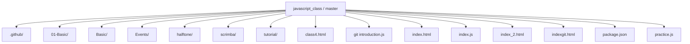
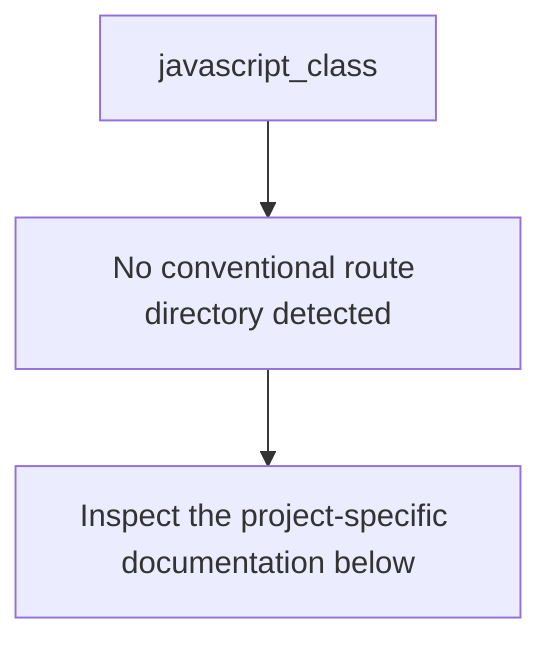
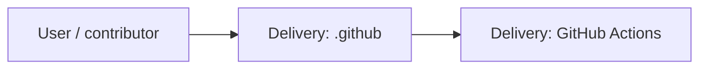
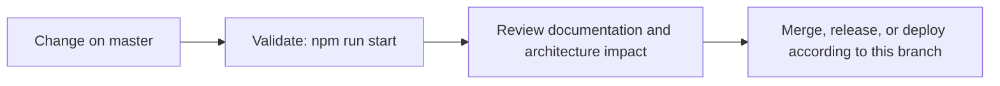

# JavaScript Class Practice

<!-- interactive-readme-standard:start -->

> [!NOTE]
> **Branch-specific documentation:** this section is maintained for [`master`](https://github.com/Nischhalsubba/javascript_class/tree/master). It is generated from the files present on this branch and preserves the project-authored README below.

<details open>
<summary><strong>Interactive repository guide</strong></summary>

## Branch overview

| Item | Value |
|---|---|
| Repository | [`Nischhalsubba/javascript_class`](https://github.com/Nischhalsubba/javascript_class) |
| Branch | [`master`](https://github.com/Nischhalsubba/javascript_class/tree/master) |
| Detected stack | JavaScript, HTML |
| Detected manifests | package.json |
| Documentation policy | Every maintained branch must explain purpose, setup, structure, architecture, flows, testing, delivery, security, and ownership. |

## Repository structure



The diagram is generated from the branch's actual top-level files and directories. Use the branch link above for complete source navigation.

## Website or application structure



## Application and responsibility flow



## Change-to-delivery flow



## README requirements for this branch

- Explain what this branch contains and how it differs from the default branch.
- Keep installation, configuration, usage, testing, deployment, security, support, and license information accurate.
- Document repository, website or application, API, data, authentication, background-job, and deployment flows when they exist.
- Prefer Mermaid diagrams and expandable `<details>` sections for visual navigation.
- Link diagrams and modules to real source paths; never invent missing components.
- Preserve project-specific documentation and update diagrams whenever architecture or major paths change.
- Treat secrets, private infrastructure, customer data, and credentials as prohibited README content.

</details>

<!-- interactive-readme-standard:end -->

A small, runnable learning repository for JavaScript classes and object-oriented programming fundamentals.

## Included examples

- constructor validation
- instance methods
- inheritance with `extends`
- parent initialization with `super()`
- method overriding
- private class fields
- getters
- encapsulated validation
- polymorphism through a shared `area()` method
- CommonJS exports for reuse

## Classes

| Class | Purpose |
|---|---|
| `User` | Basic class with validated constructor values |
| `Student` | Extends `User` and overrides `describe()` |
| `BankAccount` | Demonstrates private state, deposits, withdrawals, and validation |
| `Shape` | Base class defining a shared method contract |
| `Circle` | Implements shape-specific area calculation |
| `Rectangle` | Implements another area calculation using the same interface |

## Run locally

Requirements:

- Node.js 18 or newer recommended

Run the examples:

```bash
npm start
```

Check JavaScript syntax:

```bash
npm run check
```

No dependencies are required.

## Learning notes

The examples intentionally include input validation and error handling rather than demonstrating only the happy path. Modify the values in `runExamples()` or import the exported classes into another file for additional practice.

## Status

This is a focused learning repository, not a production application.
