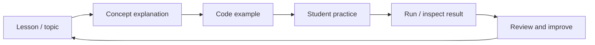
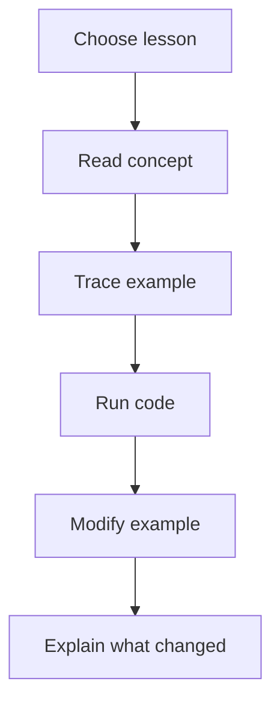
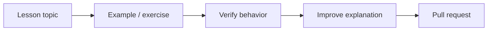

<div align="center">

# JavaScript Class

**A class-oriented JavaScript learning repository for organizing lessons, exercises, examples, and practice material around core web-programming concepts.**


[Browse source](https://github.com/Nischhalsubba/javascript_class/tree/master) · [Issues](https://github.com/Nischhalsubba/javascript_class/issues)

</div>

## Overview

**JavaScript Class** is a study repository. Treat each example as teaching material: state the concept, show the smallest useful implementation, verify the behavior, and make it easy for a learner to experiment without requiring unrelated framework knowledge.

<details open>
<summary><strong>🧭 Interactive class architecture</strong></summary>



</details>

## Learning flow



## Getting started

```bash
git clone https://github.com/Nischhalsubba/javascript_class.git
cd javascript_class
```

Open the relevant lesson or exercise and use the browser or JavaScript runtime required by that example.

## For learners, developers & educators

Keep examples small, use descriptive names, explain surprising behavior, include expected results when helpful, and avoid silently depending on files or globals that a learner cannot see.

## Discoverability

Use accurate topic terms such as **JavaScript class notes, JavaScript lessons, JavaScript exercises, JavaScript examples, web development practice, DOM, functions, arrays, objects, and async JavaScript** where those topics actually exist.

## Contribution flow


