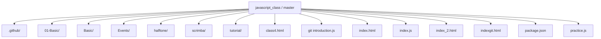
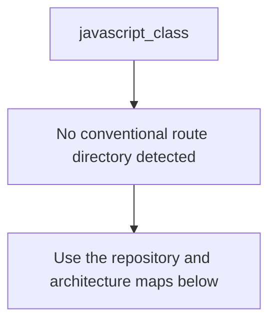
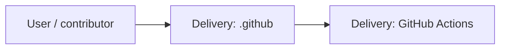
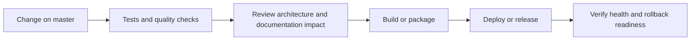
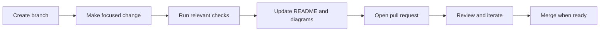

<!-- interactive-readme-standard:start -->

<div align="center">

# javascript_class

**Branch-aware technical guide for [`master`](https://github.com/Nischhalsubba/javascript_class/tree/master)**

<p>   </p>

<p>
  <a href="https://github.com/Nischhalsubba/javascript_class/tree/master"><strong>Browse source</strong></a> ·
  <a href="https://github.com/Nischhalsubba/javascript_class/issues"><strong>Issues</strong></a> ·
  <a href="https://github.com/Nischhalsubba/javascript_class/codespaces/new?ref=master"><strong>Open in Codespaces</strong></a>
</p>

</div>

> [!IMPORTANT]
> This guide is generated from the files actually present on `master`. It links to detected source paths, preserves project-authored notes, and avoids claiming components that were not found.

## At a glance

| Item | Detected value |
|---|---|
| Purpose | Runnable beginner examples for JavaScript classes, inheritance, encapsulation, validation, and polymorphism. |
| Branch role | Default branch |
| Stack | JavaScript, HTML |
| Manifests | package.json |
| Prerequisites | Node.js |
| Delivery | GitHub Actions |
| License | No license file detected |

## Branch scope

This is the repository's default branch.


## Quick start

```bash
npm install
npm run start
```

### Configuration surface

- No committed environment example file was detected.

> Never commit secrets, private keys, production credentials, customer data, or unredacted infrastructure details.

## Repository map



| Responsibility | Detected source paths |
|---|---|
| Delivery | [`.github`](https://github.com/Nischhalsubba/javascript_class/tree/master/.github) |

## Website or application map



## Architecture and responsibility flow




## Quality, security, and operations

<table>
<tr>
<td width="33%" valign="top">

### Quality

- No conventional test directory was detected automatically.

Detected commands:
- `npm run start`

</td>
<td width="33%" valign="top">

### Security

- No dedicated security policy or automated dependency configuration was detected.

Review authentication, authorization, input validation, dependency updates, secret handling, and failure recovery before release.

</td>
<td width="34%" valign="top">

### Observability

- No dedicated observability integration was detected automatically.

Define useful logs, metrics, traces, alerts, and rollback signals for production-facing branches.

</td>
</tr>
</table>

## Delivery flow



### Automation detected

- [`.github/workflows/apply-interactive-readme.yml`](https://github.com/Nischhalsubba/javascript_class/blob/master/.github/workflows/apply-interactive-readme.yml)

## Contribution flow



- Keep changes focused and explain architectural consequences.
- Run the checks relevant to the changed area.
- Update diagrams whenever routes, modules, data models, authentication, jobs, or delivery paths change.
- Add screenshots or recordings for visual behavior changes when useful.
- Use issues for reproducible defects and pull requests for reviewable changes.

## Ownership and support

| Topic | Source |
|---|---|
| Repository | [`Nischhalsubba/javascript_class`](https://github.com/Nischhalsubba/javascript_class) |
| Branch | [`master`](https://github.com/Nischhalsubba/javascript_class/tree/master) |
| Ownership | No CODEOWNERS file detected |
| Contributing | Use the contribution flow above |
| Support | [Open or review issues](https://github.com/Nischhalsubba/javascript_class/issues) |
| License | No license file detected |

<details>
<summary><strong>Documentation maintenance checklist</strong></summary>

- [ ] Purpose and branch scope are accurate.
- [ ] Setup and configuration commands still work.
- [ ] Repository, application, API, data, authentication, job, and deployment diagrams match the code.
- [ ] Tests, security controls, observability, and rollback behavior are documented.
- [ ] Links point to real files on this branch.
- [ ] No secrets or private operational details are exposed.

</details>

<!-- interactive-readme-standard:end -->

<!-- project-authored-notes:start -->
<details>
<summary><strong>Project-authored notes preserved from this branch</strong></summary>

# JavaScript Class Practice

A small, runnable learning repository for JavaScript classes and object-oriented programming fundamentals.

## Included examples

- constructor validation
- instance methods
- inheritance with `extends`
- parent initialization with `super()`
- method overriding
- private class fields
- getters
- encapsulated validation
- polymorphism through a shared `area()` method
- CommonJS exports for reuse

## Classes

| Class | Purpose |
|---|---|
| `User` | Basic class with validated constructor values |
| `Student` | Extends `User` and overrides `describe()` |
| `BankAccount` | Demonstrates private state, deposits, withdrawals, and validation |
| `Shape` | Base class defining a shared method contract |
| `Circle` | Implements shape-specific area calculation |
| `Rectangle` | Implements another area calculation using the same interface |

## Run locally

Requirements:

- Node.js 18 or newer recommended

Run the examples:

```bash
npm start
```

Check JavaScript syntax:

```bash
npm run check
```

No dependencies are required.

## Learning notes

The examples intentionally include input validation and error handling rather than demonstrating only the happy path. Modify the values in `runExamples()` or import the exported classes into another file for additional practice.

## Status

This is a focused learning repository, not a production application.

</details>
<!-- project-authored-notes:end -->
